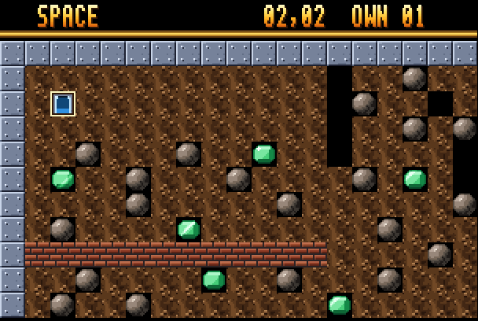
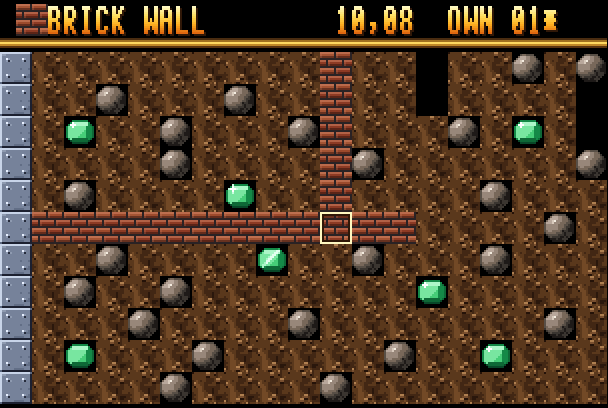
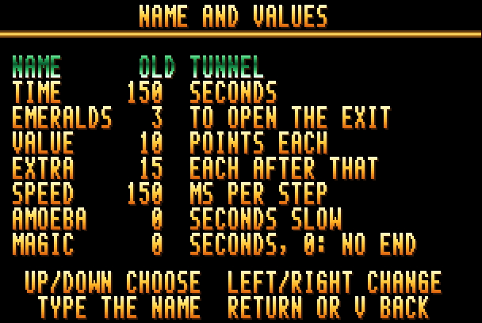
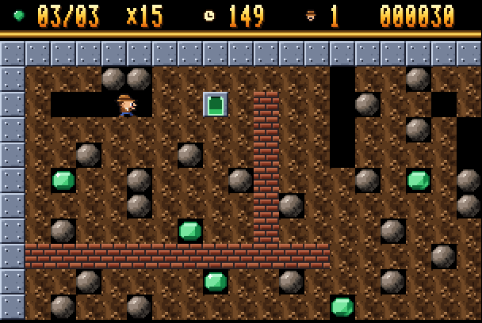
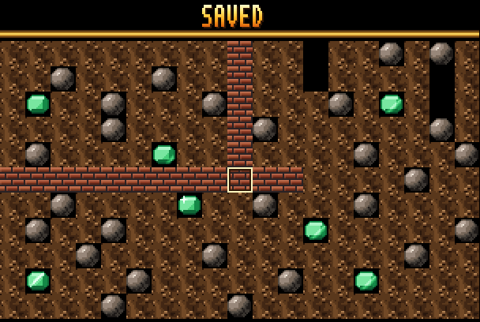
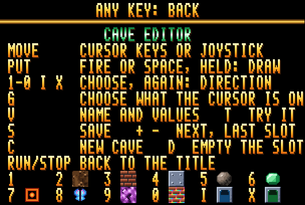
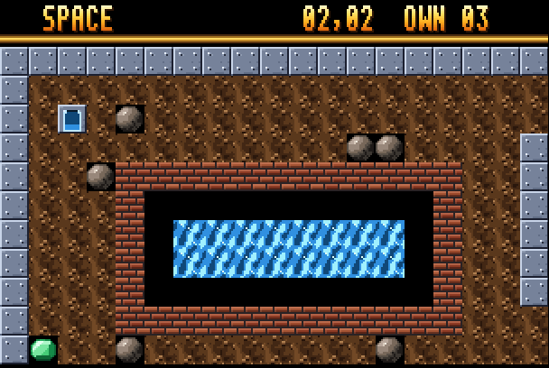
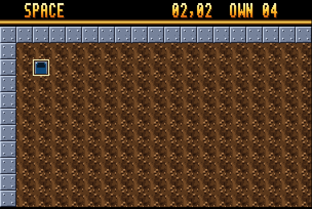
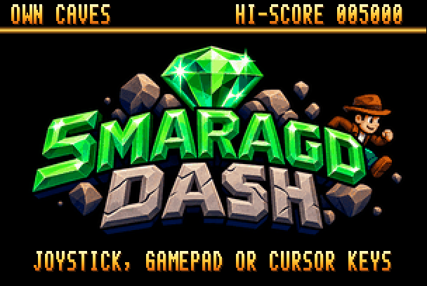

# The Smaragd Dash cave editor

Smaragd Dash has a cave editor built in. With it you draw your own caves on
the MEGA65, try them out at once and keep them on the game's disk, in twenty
slots. From the title screen you play them like the game's own caves.

**[Video: the editor in 1¼ minutes](screenshots/cave-editor.mp4)**: it shows
everything this guide describes, from loading a cave to playing the changed
one.

Contents:

- [Your first cave, step by step](#your-first-cave-step-by-step)
- [The editor's screen](#the-editors-screen)
- [Moving, putting, drawing](#moving-putting-drawing)
- [The elements](#the-elements)
- [Slots: loading, new caves, emptying](#slots-loading-new-caves-emptying)
- [Name and values](#name-and-values)
- [Trying a cave](#trying-a-cave)
- [Saving](#saving)
- [Playing your caves](#playing-your-caves)
- [The rules of the own caves](#the-rules-of-the-own-caves)
- [Caves on the PC: GDash and cavekit.py](#caves-on-the-pc-gdash-and-cavekitpy)
- [Messages](#messages)
- [All keys](#all-keys)

## Your first cave, step by step

This walk-through changes a cave that is already in slot 1. It is the same
walk as in the video. With an empty slot you start from a fresh cave
instead (see [Slots](#slots-loading-new-caves-emptying)).

**1. Open the editor.** Press **E** on the title screen. The editor loads
from the disk and shows the cave in slot 1, with the cursor (a light frame)
on cell 2,2.



**2. Choose an element and put it.** Press **6** for emeralds; the status
line now says EMERALD. Move the cursor with the cursor keys or the joystick
and press **fire**, **Space** or **Return** to put an emerald under the
cursor. In the video three emeralds go right of the inbox. Then **X** for
an exit, three cells further on, and **5** for two boulders above the
emeralds.

**3. Draw a wall.** Press **3** for brick wall. Hold fire and move: every
cell the cursor passes gets a wall. A `*` after the slot number in the
status line means the cave has changes that are not saved yet.



**4. Change the values.** Press **V**. Up and down choose a line, left and
right change its number. Here EMERALDS goes down from 12 to 3, so the new
exit opens once the three new emeralds are taken. On the NAME line type a
name; **Del** takes the last letter back. **Return** or **V** go back to the
cave.



**5. Try it.** Press **T**. The cave plays from its start with one life and
all its rules. Rockford takes the three emeralds, the exit opens, the
boulders fall into the tunnel behind him, and he walks out. The time left is
counted into the score, then you are back in the editor where you left it.



**6. Save it.** Press **S**. The cave is written into its slot on the disk;
the status line says SAVED and the `*` is gone.



**7. Play it.** Run/Stop leaves the editor. On the title screen move right
past the last start cave until the status line says OWN CAVES, then press
fire (see [Playing your caves](#playing-your-caves)).

## The editor's screen

The status line at the top shows, from left to right:

- the element chosen, as a tile and by name; for a firefly or butterfly also
  the direction it starts in (FIREFLY UP),
- the cursor's place, column and row (02,02; the cave is 40 x 22 cells,
  0-39 and 0-21),
- the slot, OWN 01 to OWN 20,
- a `*` while there are changes not saved.

Below it is the cave, as it is at its start, with all its elements standing
still. The view follows the cursor. For a few seconds the status line may
show a message instead (see [Messages](#messages)).

**H** shows the help page with all keys and the twelve elements with their
keys. Any key (or fire) goes back.



## Moving, putting, drawing

| Key | |
| --- | --- |
| cursor keys, joystick | move the cursor one cell; held, it goes on after a moment |
| fire, Space, Return | put the chosen element under the cursor |
| fire held while moving | draw: every cell the cursor passes gets the element |
| G | choose the element the cursor is on (for the twelve of the editor) |

Putting the element a cell already has does nothing. There is only one
inbox in a cave: putting a new one turns the old one into dirt.

## The elements

| Key | Element | |
| --- | --- | --- |
| 1 | space | empty; things fall into it |
| 2 | dirt | Rockford digs through it; it holds boulders and emeralds |
| 3 | brick wall | boulders and emeralds roll off it; explosions break it |
| 4 | steel wall | nothing breaks it; also the frame of a cave |
| 5 | boulder | falls and rolls; it kills Rockford when it lands on him |
| 6 | emerald | to collect; enough of them open the exit |
| 7 | firefly | follows walls; it explodes into empty space |
| 8 | butterfly | follows walls the other way; it explodes into emeralds |
| 9 | amoeba | grows; enclosed it turns into emeralds, too big into boulders |
| 0 | magic wall | turns falling boulders into emeralds and back, while it runs |
| I | inbox | where Rockford comes in (one per cave) |
| X | exit | opens when enough emeralds are collected |

**Fireflies and butterflies** start in a direction. Pressing **7** (or
**8**) again while it is chosen turns the direction on: up, right, down,
left. The status line shows it.

**Caves from GDash** (see [below](#caves-on-the-pc-gdash-and-cavekitpy)) can
have many more elements: keys and doors, water, slime, conveyor belts,
bombs, biters, teleporters and so on. The editor shows them and keeps them,
and they play as in GDash, but it cannot put them: its twelve are the ones
above. G on such an element leaves the choice as it is.



## Slots: loading, new caves, emptying

The disk has twenty slots for own caves, `OWN01` to `OWN20`. The editor
opens on slot 1 (later on the slot you had last).

| Key | |
| --- | --- |
| + | the next slot (after 20: 1) |
| - | the last slot (before 1: 20) |
| C, C again | a new cave in place of this one (not saved yet) |
| D, D again | empty the slot on the disk |

**+** and **-** load the slot from the disk. An empty slot shows a new cave:
a frame of steel wall, dirt, the inbox top left, the exit bottom right, 150
seconds, 10 emeralds needed, Boulder Dash 1's rules. That is the start for a
cave of your own. Nothing is written to the disk until you save.



**C** makes the same new cave in the slot you are on, **D** empties the slot
on the disk (an empty slot is left out when the own caves are played). Both
want the key twice, the status line asks for it. **+**, **-** and
**Run/Stop** want it twice as well when there are changes not saved:
NOT SAVED - + AGAIN: NEXT SLOT. Any other key in between cancels.

## Name and values

**V** opens the page with the cave's name and values.

| Line | Range | |
| --- | --- | --- |
| NAME | up to 21 letters | A-Z, 0-9, space and `/ : . ! - ,`; shown when the cave starts |
| TIME | 1-999 | seconds to get out |
| EMERALDS | 0-255 | emeralds to collect before the exit opens; 0: all of them in the cave |
| VALUE | 0-99 | points per emerald until the exit opens |
| EXTRA | 0-99 | points per emerald after that |
| SPEED | 50-250 | milliseconds per step: smaller is faster (the game's caves: about 150) |
| AMOEBA | 0-999 | seconds the amoeba grows slowly, then it grows fast |
| MAGIC | 0-999 | seconds the magic wall runs once started; 0: it does not stop |

Up and down choose a line (it shines). Left and right change the number;
held, it runs on, and after a while in steps of ten. On the NAME line the
keys type the name and **Del** takes the last letter back. **Return**,
**V**, **Run/Stop** or fire (not on the NAME line, where Space is a space)
go back to the cave.

A cave from GDash may have the C64's timing, where the speed comes from the
cave itself. SPEED then shows the speed it starts with; once you change it,
the cave runs in milliseconds like the others.

## Trying a cave

**T** plays the cave as it is now, saved or not, with one life and all its
rules, then comes back to the editor with the cursor where it was. The
status line shows emeralds, time, lives and score as in the game.

- Rockford's way out is the exit, as in the game: the time left is counted
  into the score.
- **Run/Stop** gives up the life when he is stuck. After he is dead, fire
  (or a few seconds) brings you back; out of time, fire.
- In a cave from GDash the status line also shows for a few seconds what
  Rockford collects (keys, skeletons, ...) and where gravity pulls; hold
  **I** to see it.

A cave needs an inbox (or Rockford himself, in caves from GDash) and an exit
to be tried or saved.

## Saving

**S** writes the cave into its slot on the disk. The `*` goes and the status
line says SAVED; if the disk cannot be written, COULD NOT SAVE.

The disk is the D81 image the game runs from. On a real MEGA65 it has to be
mounted from the SD card, as usual, and must not be write protected. In Xemu
the editor writes into the image file. Keep a copy of the image if you want
to keep your caves. A new version of the game comes on a new disk with
empty slots: take your caves along with `cavekit.py export` from the old
disk and `import` into the new one (see
[below](#caves-on-the-pc-gdash-and-cavekitpy)). Building the game with
`build.sh` keeps the slots of the old disk by itself.

## Playing your caves

On the title screen, left and right choose the cave to start with (1, 6,
11, 16, 21). Right of cave 21 comes OWN CAVES. Fire starts them: all slots
that are not empty, one after the other, with three lives; after the last
one the first comes again. Each own cave has one level, and the own caves
have no place in the high score table, which is for the game's caves.



## The rules of the own caves

The own caves play by the rules of [GDash](https://github.com/revvv/gdash-export-CrLi),
the Boulder Dash construction kit for the PC: the game has its engine for
them. A new cave starts with Boulder Dash 1's rules. What is different from
the game's own 25 caves:

- What walks off an edge comes back on the other side, unless the edge is
  steel wall. Keep the steel frame of a new cave unless you want that.
- An amoeba that grows too big (200 cells) turns into boulders; one that
  cannot grow any more turns into emeralds.
- Caves from GDash bring their own rules along (C64 engines, timing,
  effects); the editor keeps them.

## Caves on the PC: GDash and cavekit.py

`tools/cavekit.py` (Python 3, nothing else needed) moves caves between the
game's disk and the PC:

```sh
tools/cavekit.py list   smaragd-dash.d81                 # what is in the slots
tools/cavekit.py export smaragd-dash.d81 my-caves.bd     # all own caves as one GDash file
tools/cavekit.py import smaragd-dash.d81 game.bd         # into the slots, from slot 1 on
tools/cavekit.py import smaragd-dash.d81 game.bd --cave 3 --slot 5
tools/cavekit.py empty  smaragd-dash.d81 --slot 3
```

- **Sharing your caves:** `export` writes them as a BDCFF file (`.bd`), the
  format of GDash. Someone else imports it into their disk with `import`,
  or opens it in GDash.
- **Caves from GDash:** GDash comes with thousands of caves of the C64 games
  and of fans. `import` takes `.bd` files; `--cave N` (or `N-M`) picks
  caves, `--level L` (1-5) the level, `--slot N` the first slot. GDash's
  `.gds` files (imported C64 games) go through GDash: open one there and
  save it (*File → Save as*), which writes a `.bd` file.
- **Text files:** `convert` turns a `.bd` file into `.cave` text files, one
  per cave, with the map as 22 lines of 40 characters (described in
  `tools/mkcave.py`), and back; `import` takes `.cave` files as well. So a
  cave can also be drawn in a text editor.

More about this, and how exactly the caves follow GDash, is in the README,
[Own caves and GDash](README.md#own-caves-and-gdash).

## Messages

| Message | |
| --- | --- |
| THE CAVE NEEDS AN INBOX | put one (I) before trying or saving |
| THE CAVE NEEDS AN EXIT | put one (X) before trying or saving |
| SAVED | the cave is in its slot on the disk |
| COULD NOT SAVE | the disk is write protected, or it has no such slot |
| NOT SAVED - + AGAIN: NEXT SLOT | the same key again throws the changes away (also -, Run/Stop) |
| C AGAIN: A NEW CAVE | C again makes a new cave in place of this one |
| D AGAIN: EMPTY THE SLOT | D again empties the slot on the disk |
| THE SLOT IS EMPTY | done; the editor shows a new cave |
| NO GDASH ENGINE ON THE DISK | the disk lacks `SMARAGD.GD`: own caves cannot be played |

## All keys

| Key | |
| --- | --- |
| cursor keys, joystick | move the cursor |
| fire, Space, Return | put the element; held while moving: draw |
| 1-9, 0, I, X | choose the element (again for a firefly or butterfly: its direction) |
| G | choose the element under the cursor |
| V | name and values |
| T | try the cave |
| S | save it into its slot |
| + / - | next / last slot |
| C (twice) | a new cave |
| D (twice) | empty the slot |
| H | help page |
| Run/Stop | back to the title |
