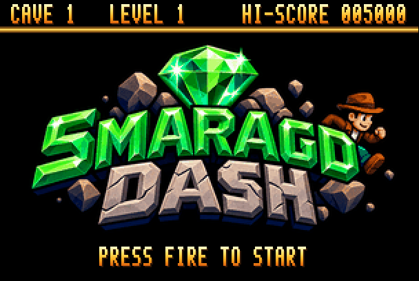
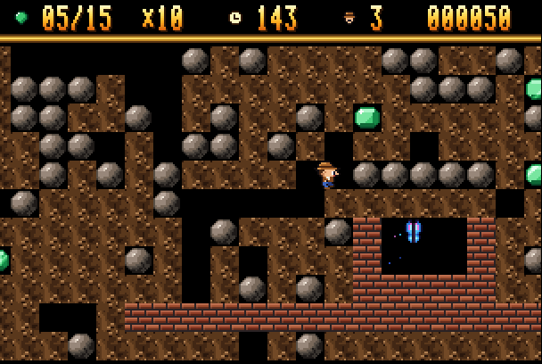
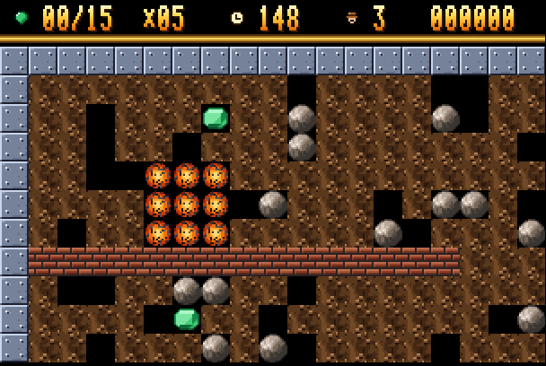
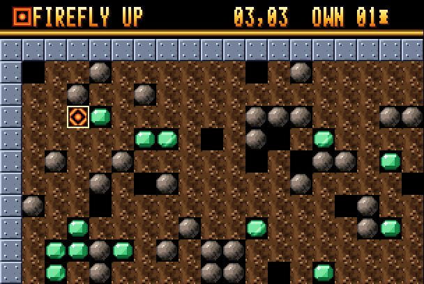

# Smaragd Dash

A Boulder Dash style game for the MEGA65: dig through the cave, collect
emeralds, mind the boulders, reach the exit before the time runs out.

The aim is to play like the original Boulder Dash on the C64, with clearly
better graphics. All caves play by the rules of
[GDash](#own-caves-and-gdash), the Boulder Dash construction kit for the
PC, whose engine the game has (with Boulder Dash 1's rules for its own
caves); levels and graphics are our own. Rockford is the adventurer from the title logo
(`gfx/logo.png`).

There are 25 caves, each in four levels, as in the original: 100 in all.
On the title screen the joystick picks the level (up and down) and the cave
to start with (left and right: 1, 6, 11, 16 or 21). After the last cave
the game goes on with the first one of the next level.

Right of cave 21 come the **own caves**: twenty slots on the disk for caves
made with the game's [cave editor](#cave-editor) (E on the title), or
brought over from GDash with `tools/cavekit.py`, with all of its
elements.

The title screen plays our own title music in stereo: six voices on two
SIDs, with chord arpeggios, a filtered bass, drums and an echo of the
melody on the right channel. Fire starts the game, E the cave editor. The
line under the logo takes turns: "press fire", the controls, and the
version (the file `VERSION`, which is also in the disk's name).

### High scores

As in the arcades: the best eight scores, each with three letters, the
score and the cave and level where the game ended. The title screen shows
the table in turn with the logo (15 seconds logo, 10 seconds table); the
best score is in its status line. Gold, silver and bronze for the first
three, ice blue for the others.

When a game ends with a score for the table, the game asks for the three
letters: up and down go through the letters (A-Z, 0-9, `.`, `-`, `!` and
space; held, they repeat), fire or right takes one, left goes back. Or type
them: a letter or digit is taken at once, Del goes back. There are 30
seconds for it; then the letters stay as they are. The next entry starts
with the last name. After that the table comes first on the title, the new
entry shining green with Rockford walking beside it.

The table is written back to the disk at once (`SMARAGD.SCORES`), so it is
still there the next time; a new build keeps it, too (`mkd81.py --keep`).
To start again from the default table, delete `build/smaragd-dash.d81`
before building.



 

**[Video: the game plays the first six caves](screenshots/first-six-caves.mp4)**
(4½ minutes, with music and sound; recorded as described under
[Screencast](#screencast)).

## Controls

| | |
| --- | --- |
| joystick (either port), gamepad, cursor keys | move; on the title: up/down level, left/right first cave |
| fire, Space, Return + direction | snap: take dirt or an emerald next to you without moving |
| P | pause |
| Run/Stop | give up the life (when you are stuck) |
| I (held, in a cave from GDash) | what Rockford carries and where gravity pulls |
| up/down, fire/right, left; or type | the name for the high score table |
| E (on the title) | the cave editor |

## Cave editor

**[The editor's guide: EDITOR.md](EDITOR.md)**, step by step, with pictures.
**[Video: the editor](screenshots/cave-editor.mp4)** (1¼ minutes: loading
slots, putting and drawing elements, values and name, trying the changed
cave to its exit, saving it and loading it again)

E on the title screen opens the editor on the first slot. It shows the
cave as it starts, with a cursor; the status line names the element
chosen, where the cursor is, the slot, and a `*` while there are changes
not saved. H shows the keys:

| | |
| --- | --- |
| cursor keys, joystick | move the cursor (held: on and on) |
| fire, Space, Return | put the element chosen; held while moving, it draws |
| 1-9, 0, I, X | choose: space, dirt, brick wall, steel wall, boulder, emerald, firefly, butterfly, amoeba, magic wall, inbox, exit |
| the same key again | a firefly or butterfly gets its next starting direction (up, right, down, left) |
| G | choose the element the cursor is on |
| V | the name and the values: time, emeralds needed, points per emerald before and after the exit opens, speed (milliseconds per step), amoeba and magic wall times |
| T | try the cave (one life), then back in the editor |
| S | save it into its slot on the disk |
| + and - | the next and the last slot |
| C | a new cave: steel frame, dirt, inbox and exit |
| D | empty the slot on the disk |
| Run/Stop | back to the title |
| H | the keys |

The own caves play by GDash's rules (see below): what walks off an edge
comes back on the other side, unless the edge is steel, as in a new cave.
There is one inbox: putting a new one turns the old one to dirt. A cave can
be tried and saved when it has an inbox (or, from GDash, Rockford himself)
and an exit. What would lose changes
not saved - another slot, Run/Stop - and the keys C and D want to be pressed
twice. On the values page up and down choose a line, left and right change
it (held: faster after a while), and the name is typed (Del goes back);
Return or V go back to the cave. A cave from GDash keeps all its other
properties; its speed, if it had the C64's timing, becomes milliseconds once
it is changed.



The own caves are played from the title (right of cave 21): one after the
other, empty slots left out, with three lives as usual; after the last one
the first comes again. They have one level each and no place in the high
score table, which is for the game's caves.

## Building and running

In VS Code: open any file of the folder and press **F5**. Without the editor:

```sh
.vscode/run-current.sh smaragd-dash/        # from the repository root
smaragd-dash/build.sh                       # build only
```

`build.sh` generates the graphics (`tools/mkgfx.py`) and the music
(`tools/mkmusic.py`) into `build/gen/`, the caves (`tools/mkcave.py`) into
`build/caves/`, then compiles everything into `build/smaragd-dash.prg` and
puts it on the disk image `build/smaragd-dash.d81` together with the tiles
(`SMARAGD.TILES`), the title logo (`SMARAGD.LOGO`), the high scores (`SMARAGD.SCORES`), the caves
(`CAVE01-1` ... `CAVE25-4`: cave and level), the slots for the own caves
(`OWN01` ... `OWN20`), GDash's engine (`SMARAGD.GD`, `SMARAGD.LOW`) and the
editor (`SMARAGD.EDIT`); the screencast build adds
its moves (`DEMO01`, ...; see below). F5 starts
the disk (`-8 … -autoload`). Started as a bare PRG, without the disk, the
title shows the name in big letters instead of the logo, the tiles stay
black, and there are no caves to play. `build/preview.png` shows all tiles enlarged,
`build/preview-logo.png` the logo as the MEGA65 shows it.

`memmap` tells `toolchain/tools/bin/mega65-mem` what the linker does not
know: the DMA list, framebuffers, screens and status characters in banks 4
and 5, the colour RAM, and what the files on the disk are and where they
are loaded. Then

```sh
toolchain/tools/bin/mega65-mem smaragd-dash/  # from the repository root
```

shows the whole RAM with what is free, the program by source file, and the
disk; it also checks that the caves, the moves and the high scores fit
the variables they are loaded into.

`tests/run-all.sh` runs all of the tests below, one after the other, with a
line for each and the logs in `build/test/` (`--host`: only those on the
host, a minute; with Xemu some 15 minutes more).

The tests of `tools/cavekit.py` run on the host, `python3 tests/test_cavekit.py`.
`tests/test_gdengine.sh` plays caves of GDash's own collection with the
game's GDash engine on the host, step by step beside GDash's own code (see
[below](#own-caves-and-gdash); `--all` for all of them, `--gds` for the C64
games GDash imports), with pseudo-random input. `python3
tests/test_mechanics.py` makes every mechanic of the engine happen: each
small cave in `tests/mechanics/` (and the demo caves) has moves that make
one thing happen - a bladder pushed every way, the hammer, nitro going off
in a chain, slime, a chasing boulder, a voodoo hurt, ... - and `=` lines
that say what must come of it; each is played step by step beside GDash
(`gdash-oracle moves`), comparing the map and all the player has after
every step, and with the game's random numbers. With `--coverage` it tells
how much of `src/gdengine.c` it runs; together with GDash's collection all
but four lines (a diagonal input the game never sends, two default cases,
a corner of GLib's random numbers). `tests/test_editor.sh`
tries the editor and GDash's engine in Xemu: built with `-DEDITTEST=n`, the
game takes its keys from a script (`test_script` in `src/main.c`) and stops
at its n-th stop; the screens of the eleven stops land in `build/test/`,
and at the end the cave the script saved is checked on the disk. It builds
the normal game again afterwards.

What runs on the MEGA65 in assembler has its C original beside it, which
the host's tests check; two tests check the assembler against it in Xemu.
`python3 tests/test_gdmega65.py` plays some 200 caves of GDash's
collection and the mechanics' scenarios (or the files given) with GDash's
engine as the MEGA65 runs it (built with `-DGDCHECK`: a digest of every
step, `src/gddigest.h`, into bank 4; a scenario's moves in the slot's file
`CHECKnn`) and compares each step with `tests/gdplay.c` on the host; if
Xemu hangs, it names the cave. `python3 tests/test_flow.py` plays the
game's flow in Xemu from a script (built with `-DFLOWTEST`) that waits for
what happens rather than for frames: a cave picked on the title, five caves
one after the other with an extra life at 500 points, on into the next
level, pause, the time running out, Run/Stop, game over, the name typed
into the high score table, the table on the disk and on the title, which
then runs for a minute; the disk has small caves of its own for that.
`tests/test_render.sh` lets the screencast
build make each frame's DMA jobs with `src/render.s` and with the C loop
(`-DRENDER_CHECK`), counts the frames where they differ, and checks that
it got through all the caves. Built with `-DGDPROF`, the game measures how
long GDash's engine and the frames take (by CIA 1's timer, read from a
memory dump), with `-DGDPROF_ENGINE` also the parts of a step.

The slots for the own caves (`OWN01` ... `OWN20`, see `tools/mkcave.py`)
go onto the disk empty; like the high scores, a new build keeps them from
the old disk.

## Own caves and GDash

[GDash](https://github.com/revvv/gdash-export-CrLi) is a Boulder Dash
clone and construction kit for the PC, with thousands of caves of the
C64 games and of fans in its BDCFF files (`.bd`). `tools/cavekit.py` (it
needs nothing but Python 3) brings them onto the game's disk and back:

```sh
tools/cavekit.py list   game.bd                     # its caves
tools/cavekit.py import smaragd-dash.d81 game.bd    # into the slots, from slot 1 on
tools/cavekit.py list   smaragd-dash.d81            # what is in the slots
tools/cavekit.py export smaragd-dash.d81 own.bd     # the own caves for GDash
tools/cavekit.py empty  smaragd-dash.d81 --slot 3   # empty a slot
tools/cavekit.py convert game.bd caves-dir/         # .bd -> .cave files (and back)
tools/cavekit.py disks  smaragd-dash.d81 game.bd --out disks/  # disks to play a whole game on
```

`import` takes all caves of the file in level 1, or `--cave N` or `N-M`,
`--level L` (1-5) and `--slot N` to start with; `--as NAME=NAME2` puts one
element in place of another. `disks` puts a whole game onto copies of the
disk, 20 caves each (`game.d81` or `game-1.d81`, `game-2.d81`, ...), to be
played as the own caves. All commands also take GDash's `.gds` files: they
go through GDash's own code, `toolchain/tools/bin/gdash-oracle` (or
`$GDASH_ORACLE`), which saves them as `.bd` as GDash does.

All caves play by GDash's rules: the game has GDash's engine
(`src/gdengine.c`, a port of its `caverenderedengine.cpp`, MIT license), with
all of its elements - the expanding walls and slime of Boulder Dash 2, keys
and doors, bombs, bladders, biters, teleporters, water, conveyor belts, ...
-, its properties, the timing of its engines (the C64's included, whose
speed comes from the cave's delay and how full it is) and its wrapping round
the edges. `cavekit.py` takes a cave as GDash draws and starts it: from its
objects - lines, rectangles, random fills with the C64's random numbers -,
its properties with GDash's defaults and those of the C64 engines
(`Engine=BD1`, ...). Both are checked against GDash's own code, built as a
test oracle (`toolchain/tools/gdash-oracle`, see `tests/test_gdengine.sh`):
of GDash's collection (200 `.bd` files, 5016 caves) every cave starts as in
GDash in all five levels - every value, every cell - and plays as there,
step by step for 400 steps with the same input, in all 24940 cave-levels
that are not random anew in every game. On the MEGA65 the game takes its
own random numbers for them, as GDash takes new ones in every game.

Mazes are carved as GDash carves them; one that GDash makes anew in every
game gets a maze of its own. Each of GDash's elements has a tile of its own
(115 more of them, after the game's own), animated where GDash's are; the
switches show whether they are on, and a cave's "looks like" effects (dirt,
expanding walls, the second amoeba) are drawn as in GDash. GDash's second
status line is there too: the keys, skeletons, the sweet, the hammer and the
diamond key Rockford has, and where gravity pulls (with the seconds until it
turns). It shows for three seconds when any of it changes, while gravity is
about to turn, and while I is held.

GDash's `.gds` files - the C64 games it imports, about 1850 of its
collection - go through GDash: open one there and save it (*File → Save
as*), which writes BDCFF for `cavekit.py` (or let `cavekit.py` do it with
the oracle, as above). That way is checked too
(`tests/test_gdengine.sh --gds`): of their 33411 caves 33409 play as GDash
plays the original for 200 steps. In one GDash saves a probability rounded
to four places; in the other the amoeba starts as "already scanned", which
a slot cannot hold, so it grows a step later. GDash saves an amoeba
threshold bigger than the cave (as these games have it) as a part above 1,
but refuses that when it loads the file again; `cavekit.py` takes it (and
so does the test oracle, which has this one fix).

### Demo caves

`demo/` holds four caves (GDash's `.bd` files) that show every element of
GDash's engine at work, each with the moves that solve it:

| Cave | |
| --- | --- |
| `1-rocks-and-earth` | boulders and emeralds sliding off sloped walls, glued and loose things, nut, magic wall, mega boulder and sweet, box, flying boulder and emerald, waiting and chasing boulder, falling wall, clock, eatable walls |
| `2-creatures` | fireflies, butterflies (both kinds), stonefly, dragonfly, cow, ghost, creature switch, replicator and voodoo, slime, biter, bladders, amoeba and amoeba 2 |
| `3-keys-and-machines` | keys and doors, diamond key and trapped emeralds, conveyor belts, expanding (steel) walls and their switch, teleporter, pneumatic hammer with walled emerald and key, skeletons and pot, gravity switch, time penalty and gravestone, hidden outbox |
| `4-water-fire-and-explosives` | down-sloped walls with flying things, bomb, explodable steel, rocket launcher, ghost explosion, nitro pack, lava, acid, water, cow turned skeleton, amoeba 2 exploding by the amoeba |

`cavekit.py import` brings them onto the disk like any GDash file.
`tools/democave.py play demo/NAME.bd demo/NAME.moves` plays one on the host
with the game's engine (started with the screencast's random numbers) and
tells how it ends; `!` in the moves shows the map there. The moves are
`U R D L` (`u r d l` with fire), `.` to wait, `X` to give up, a number in
front repeats, `L*` repeats until Rockford gets there (a push that works
only now and then); a line that starts with `=` says what must be so at
that point (`= key1=1 @12,5=DIAMOND st=out`, see `tools/democave.py`).

`tools/record-tour.sh` films them being solved: the caves go into the slots
of a disk of the game built with `-DSCREENCAST -DTOUR`, their moves onto it
as `TOUR01`, `TOUR02`, ...; the game plays one after the other and the
recording ends after the last (`build/tour.mp4`).

### Screencast

*Terminal → Run Task… → MEGA65: Record screencast (active program)* (or
`MEGA65_CAST=1 .vscode/run-current.sh smaragd-dash/` from the repository
root) records the game playing itself as `build/smaragd-dash.mp4`, with
the music and the sounds: the title for fifteen seconds, then all caves of
level 1, solved.
Built with `-DSCREENCAST`, the game presses fire on the title by itself,
loads the moves for each cave with it from the disk (`DEMO01`, `DEMO02`, ...,
written by the solver as `build/caves/demoNN.bin`; only this build puts
them on the disk), and stops the emulator after the last cave, which ends
the recording. `-DDEMO_LAST=6` in `MEGA65_CFLAGS` makes it stop after the
sixth.

The moves come from `tools/solve.c`, which `build.sh` compiles and runs on
the host at every build. It plays the caves with GDash's engine as the game
has it (`src/gdengine.c`), step by step as `play_cave` gives them: from the
nearest few emeralds it picks one, walks there, round falling things and
away from creatures, until the exit is open, and takes back any choice that
gets Rockford killed or stuck. What it cannot find by itself - dropping
boulders on purpose, pushing one aside - a cave gives it as opening moves
(the `demo` key of its `.cave` file); the search goes on from there. If it
finds no way through a cave, the screencast ends before that cave. As the
screencast build starts the engine's random numbers (pushing a boulder works
one time in four) as the solver does, the same moves play the same in the
game. So a changed cave or rule gives new
moves with the next build.

The pictures in `screenshots/` were taken with Xemu's `-headless -screenshot`,
the video `screenshots/first-six-caves.mp4` with

```sh
MEGA65_CFLAGS=-DDEMO_LAST=6 MEGA65_CAST=1 MEGA65_CAST_OPTS="-x 1 -s 2" \
    .vscode/run-current.sh smaragd-dash/
```

(the first six caves, original size, without the boot screen) and copied
there. `tools/record-editor.sh` records `screenshots/cave-editor.mp4` as
`build/cave-editor.mp4`: built with `-DEDITDEMO`, the game plays the
editor's video script (in `src/main.c`, beside the editor's test script) on
a disk with the caves of `tools/editor-demo/` in its slots.
`tools/record-editor.sh --shots` takes the pictures of `EDITOR.md`
(`screenshots/editor-*.png`) at the script's stops.

## How it works

| File | |
| --- | --- |
| `src/engine.h` | what the game knows of a cave while it plays (the player, moves, events, sounds) |
| `src/gdengine.c` | GDash's engine, which plays all caves (in bank 2, `gdengine.ld`; called through `src/gdfar.s`, entry points in `src/gdjump.s`) |
| `src/gdscan.s`, `src/gdcell.s` | its passes over the cave and its cell access in assembler |
| `src/gddigest.h` | a step's digest, to compare the engine on the MEGA65 with the host's |
| `src/main.c` | the game: title screen, covering and uncovering, steps, camera, status line, lives, high score screens, the cave editor |
| `src/hiscore.c` | the high score table and its file |
| `src/mem.h` | where everything lies that the linker does not place: DMA list, tiles, logo, framebuffers, status line, screens |
| `src/video.c` | screen setup, drawing via DMA, status line, text screens |
| `src/render.s` | the DMA jobs of a frame's playfield in assembler |
| `src/input.c` | joysticks and keyboard |
| `src/sound.c` | sound effects on the first and third SID (left and right) |
| `src/music.c` | music player on the second and fourth SID |
| `src/disk.c` | loading files from the disk, and writing one back, through the floppy controller |
| `src/dma.c` | DMA lists: copying and filling, for the screen and the loader |
| `tools/mkgfx.py` | draws all graphics in code, builds the palette |
| `tools/mkcave.py` | converts the cave files for the disk (and into C for `solve.c`), makes the empty slots |
| `tools/cavekit.py` | own caves: GDash's files onto the disk and back, `.cave` files |
| `tools/record-editor.sh`, `tools/editor-demo/` | the editor's video and its caves |
| `tools/solve.c` | finds the moves through the caves for the screencast (runs on the host) |
| `demo/`, `tools/democave.py`, `tools/record-tour.sh` | the demo caves, their moves, and their video |
| `tools/mkmusic.py` | the title music as text, converted into tables |
| `caves/*.cave` | the caves, as text |
| `gfx/logo.png` | the title logo (scaled down by `tools/mkgfx.py`) |
| `memmap` | `src/mem.h` and the disk's files again, for `mega65-mem` |
| `link.ld`, `gdengine.ld`, `shared.ld` | the program, GDash's engine, and what they share at $C000 |

**The rules** of the game's caves are Boulder Dash 1's as GDash has them
(`tools/cavekit.py`'s `gd_from_cave`, in milliseconds): the cave is scanned
once per step from top left to bottom right, and what moves down or right
is marked so it is not moved twice. Boulders and emeralds fall, and roll off boulders,
emeralds and brick walls when there is room beside and below. Only a falling
one kills. Rockford pushes a boulder sideways only now and then (one try in
four). Fireflies try to turn left, butterflies right; touching Rockford or
the amoeba blows them up, and butterflies leave nine emeralds. The amoeba
grows slowly, then fast; shut in it turns to emeralds, at 200 cells to
boulders. The magic wall turns boulders into emeralds and back for a while.
A step takes the cave's `speed` (160 ms in the first cave); Rockford moves
one cell per step and the screen is redrawn every frame. What moved in a
step - Rockford, boulders, emeralds, fireflies, butterflies - slides from
its old cell into the new one until the next step, so it always ends up in
its cell: the rules stay in cells, only the drawing is smooth. The engine
notes the moves of each step (`moved[]`) for that, and what else happened
(`gd.events`: dust where a boulder lands, crumbs of dug dirt, sparks
behind fireflies and butterflies).

**Rockford** is drawn from eight sides (`mkgfx.py` puts him together from
a head, a body and legs; the left sides are the right ones mirrored) and
turns from one to the next, a frame each, when he changes direction:
from right to left he turns round past the front. He walks with a step
per cell, in time with the sliding - legs apart in the first half of the
cell, passing in the second, the arms swinging the other way - so his feet
keep up with the ground; pushing against a boulder or a wall, he walks on
the spot. When he stops he keeps his direction for a moment, then turns to
the front, where he blinks and taps his foot now and then.

**Little things** stay behind for a moment, on empty cells only: where a
firefly was, a few embers that rise a little and die down quickly; where a
butterfly was, a soft glitter in the colours of its wings that fades
slowly, so its quick round looks calmer; crumbs where Rockford digs, and
a puff of dust beside a boulder that lands. Each emerald sparkles at its
own moment. The engine notes where something happened (`events[]`, like
`moved[]`; the rules use neither), `main.c` draws it with tiles from
`mkgfx.py`.

**Text on the title screens** - the line under the logo, the lines of the
high score table - is drawn eight letters per frame: a whole line at once
took longer than a frame, and the music stumbled.

**The screen** is 40x25 characters in full-colour mode (256 colours, one
byte per pixel). Rows 0-1 are the status line, row 2 a thin line, rows 3-24
the playfield: 19 x 11 tiles of 16x16 pixels. Every playfield character is
unique, so the playfield is a framebuffer (banks 4 and 5, two of them,
alternating). Its characters are stored column by column, so the pixel rows
of a column follow each other 8 bytes apart and a tile half lands on any
pixel row with one DMA copy: about 480 chained DMA jobs draw the view each
frame, and vertical scrolling costs nothing extra. What slides between two
cells is drawn afterwards over an empty cell, with DMA transparency for
pixel value 0: on a character column as two tile halves, otherwise one DMA
job per pixel column, which copies every 8th byte of the tile into every
8th byte of the framebuffer column (the DMA's skip rate). Their list (6K) lies
below the program at $0800, where BASIC had its screen; the game never
goes back to BASIC. Horizontal fine scrolling
moves the character generator (TEXTXPOS); it is switched while the thin line
is drawn, whose pixel rows are single colours, so the status line stays in
place. The frame loop: game logic during the vertical blank, the
switch at the line, drawing, then waiting for the next blank to show the new
framebuffer. The cave's clock goes by the MEGA65's frame counter, so a frame
that takes longer does not slow the cave down; a step of GDash's engine
takes as long as it says (at most 25 a second, as in GDash). The view moves
with Rockford: inside a box of 64 x 32 pixels round the middle he walks on
a still cave, beyond it the cave moves under him exactly as far as he goes,
frame by frame (a jump, as through a teleporter, at most 8 pixels a frame).

**The music** is written in `tools/mkmusic.py`: a chord per bar, the
melody as note names with lengths in sixteenths, bass and drum patterns, and
instruments (waveform, envelope, pulse width sweep, vibrato, arpeggio, pitch
sweep for the kick drum). The player in `src/music.c` steps one row every
6 frames (125 beats per minute; at 60 Hz it leaves out every sixth
frame, so the tempo stays), closes each note's gate shortly before the
next note, and slowly opens and closes the filter on the bass. The left SID
plays melody, bass and chords, the right one the echo, the bass again and
the drums.

**The memory.** The game needs neither the KERNAL nor BASIC nor the DOS:
it switches the KERNAL out and loads with its own loader. So the RAM under
the KERNAL at $E000 takes the editor's code (an overlay, `SMARAGD.EDIT`,
loaded when the editor opens), and banks 2 and 3, where the C65 ROM lies,
are made writable at the start (the hypervisor's call $70; a reset loads
the ROM again). Bank 2 holds GDash's engine (`SMARAGD.GD`, 27K): it is
linked on its own for $4000-$BFFF and shows there only while it runs - the
calls in `gdfar.s`, at $1F80 behind the DMA list (`SMARAGD.LOW`), map it in
and out with the 45GS02's MAP. What the program and the engine share -
the cave, `moved[]`, the engine's state, the cave file - lies at $C000
(`shared.ld`), outside that window; the program itself ends below $C000.
The engine has the KERNAL's zero page from $90 for its own, and two
variables of the program (`tiles[]`, `glyph[]`) lie in the KERNAL's and
BASIC's work area at $0200 (`link.ld`'s `.lowbss`).

**The assembler.** What runs most often is 45GS02 assembly, each beside
the C it replaces (which the host's tests use, see above): in GDash's
engine the pass over the cave (`src/gdscan.s`: the cells, the ones that
only lie still skipped at once, the player found on the way) and the
access to a cell (`src/gdcell.s`: `cell`, `get`, `store`, `has_flag`);
in the program the DMA jobs of a frame (`src/render.s`). A step of GDash's
engine takes 2.5-6 ms in a full cave (it took up to 50 ms in C), and the
cave's clock goes by the MEGA65's frame counter, so a longer one does not
slow it down.

**The title logo** (288x144 pixels, 41K) lies in bank 3, from where DMA
copies it into both framebuffers for the title screen. The tiles (200 of 256
bytes) have bank 1 to themselves, from $10000 up to the colour RAM at
$1F800 - room for 248: they are only ever copied by DMA, so they need not
lie in bank 0, which keeps its room for code. `mem.h` checks at compile
time that tiles and logo fit.
`mkgfx.py` scales it down and gives it palette 1: all entries the status
font and icons do not use (they keep theirs, so the status line looks the
same); the title screen switches the text palette to 1, the game back to 0.

**The caves** come from the disk as well, one file each, loaded when the
game gets to them; after the last cave of a level on the disk the game goes
on with the first one of the next level, and after the last level it stays
there. So the program holds no maps, and more caves cost no memory; it only
knows how many there are (`levels.h`, written by `mkcave.py`), for the
choice on the title.

**The loader** (`disk.c`) does without the KERNAL: it finds the file in
the D81's directory and reads its sectors through the F011 floppy
controller, waiting for each one by polling and copying it with DMA from
the controller's sector buffer ($FFD6C00). It needs neither the ROM nor
interrupts, so it works at any time, and after each sector it calls a
hook: while loading, the status line shows an emerald that turns. It
reads the disk image mounted in drive 0; a real floppy would also need the
head stepped to the track. Writing goes the other way: `disk_save`
rewrites a file that is on the disk already, in place - each sector is
read, changed in the controller's buffer and written back. That is how the
high scores get onto the disk: `build.sh` puts a file of one sector there,
`hiscore.c` fills it.

Without the logo the title text is drawn with the status font; the big
letters are the same font at twice the size, in 16 palette entries of
their own that the title screen cycles for the shine.

## Cave files

See `tools/mkcave.py` for the format; the map characters are the ones of
BDCFF, so `tools/cavekit.py convert` turns them into GDash's files and
back. A cave is 40x22 cells with a steel frame. The first six follow the first caves of Boulder Dash 1 in idea, not
in layout; the others bring one idea each, getting a little harder from cave
to cave - more boulders and creatures, a little less time to spare - but
always with time to look around: each limit is at least three and a half
times what the solver needs (the maze and the amoeba, where it has to wait,
twice), and no cave asks for much more than half of
its emeralds unless it makes more of them (magic walls, butterflies, the
amoeba). Like the original's, most are a random fill with walls, rooms and
creatures drawn over it.

From cave 7 on, a few elements of GDash that stay close to Boulder Dash 1
come in, one at a time, each first in a cave that shows it, then together
with the others: the **clock** (more time; `clock` seconds, 10 unless the
cave says), the **nut** (a boulder falling onto it cracks it, and an
emerald comes out), the **expanding wall** (grows sideways, `x`, up and
down, `v`, or every way, `e`, into what is dug out beside it), **slime**
(lets boulders, emeralds and nuts fall through now and then: `slime`, as
the C64 games have it) and the **hidden exit** (`H`, which looks like steel;
it sits in a brick wall, where a steel block stands out). The rest of
GDash's elements - keys, doors, bombs, teleporters, ... - stay for the own
caves.

| | | needs | |
| --- | --- | --- | --- |
| 1 | FIRST STEPS | 12 in 150 s | dirt, boulders and emeralds |
| 2 | ROOMS | 20 in 120 s | brick walls make six rooms; two fireflies wait in theirs |
| 3 | MAZE | 22 in 120 s | a maze with emeralds in its dead ends; fireflies guard three of them |
| 4 | BUTTERFLIES | 36 in 150 s | dig under the boulders above the hall: a butterfly hit by a falling one leaves nine emeralds |
| 5 | ENCHANTED WALL | 30 in 150 s | boulders falling through the magic wall come out as emeralds, for 20 seconds |
| 6 | AMOEBA | 40 in 150 s | drop the two boulders into the openings of the nest before the amoeba gets out: shut in, it turns to emeralds |
| 7 | FIREFLY DENS | 18 in 120 s | four fireflies circle in their dens. New: the clock - two in the open, one in a den |
| 8 | TREASURE ROOM | 24 in 45 s | a small room full of emeralds and too little time, but two clocks of 15 s |
| 9 | BOULDER RAIN | 20 in 120 s | plenty of boulders over plenty of holes. New: the nut - eight under boulders, for them to crack |
| 10 | TRACKS | 22 in 120 s | fireflies run up and down brick tracks; cross at the ends. New: the expanding wall, growing sideways |
| 11 | BUTTERFLY GARDEN | 24 in 120 s | a butterfly in each garden, a boulder above it; nuts between the gardens |
| 12 | STAIRWAY | 24 in 120 s | brick stairs; what lies on them rolls. New: the expanding wall growing up and down |
| 13 | VEINS | 26 in 100 s | emeralds run through the rock in veins. New: slime - two veins drip through it, one emerald at a time |
| 14 | MAGIC WELLS | 26 in 130 s | three wells with a magic floor, boulders above them; over one, slime that lets its boulders seep in |
| 15 | VAULTS | 28 in 120 s | small brick vaults with emeralds, one door each. New: the hidden exit, a steel block in a vault's wall |
| 16 | AMOEBA FIELD | 26 in 120 s | the amoeba spreads from a corner; at 200 cells it turns to boulders. Expanding walls in its way |
| 17 | CAVERNS | 20 in 110 s | big caverns with fireflies circling in them; nuts and two clocks |
| 18 | LABYRINTH | 24 in 150 s | a bigger maze, and fireflies in it; the exit hidden in its walls, clocks in dead ends |
| 19 | WATERFALL | 28 in 100 s | emeralds and boulders stacked in shafts; dig below and they pour out - two trickle through slime |
| 20 | ROCKFALL | 28 in 110 s | more boulders than dirt, and a slightly faster step; nuts and a clock |
| 21 | SWARM | 26 in 110 s | butterflies round the amoeba's nest blow up into emeralds when it reaches them; expanding walls between |
| 22 | MAGIC FACTORY | 32 in 120 s | two magic floors, one above the other; nuts come through them as nuts, for the boulders to crack |
| 23 | FORTRESS | 32 in 100 s | a brick fortress full of emeralds, fireflies at the gates, expanding walls inside, the exit hidden in its wall |
| 24 | SERPENTINE | 32 in 130 s | one long way back and forth; clocks at the turns, expanding walls, nuts |
| 25 | GRAND FINALE | 40 in 150 s | a bit of everything: maze, magic floor, fireflies, the amoeba, nuts, slime, expanding walls, clocks, the hidden exit |

The table shows level 1. As in Boulder Dash 1, every cave comes in four
levels, which `mkcave.py` makes from the one map: each level gives a tenth
less time (in steps of 5 s), asks for a tenth more emeralds and steps 5 ms
faster than the one before, and its random fill is different. The original
fills each level of a cave from its own seed; here the dirt, boulders and
emeralds of the fill swap places with others close by (up to three cells
to the side, one up or down), so every part of the cave keeps its mix and
its idea. What is next to walls, creatures, the exit, the inbox or the way
of the opening moves (`demo`) stays as drawn. A cave can give its own
values per level, keep its map (`shuffle = no`) or name other seeds; the
maze, the amoeba cave and the grand finale give their own times or emerald
counts, four caves other seeds. At every build the solver plays all 100
and names any it finds no way through; at present it solves all of them,
with at least 1.6 times the time it needs (the maze in level 4) - without
the clocks, which it takes only when they lie on its way.
