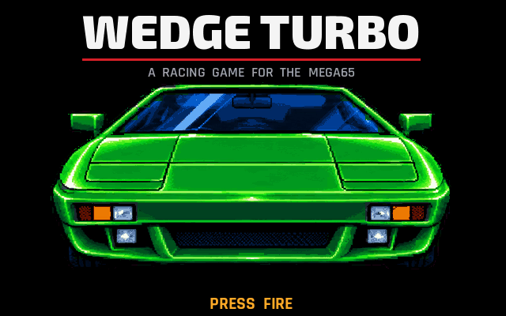
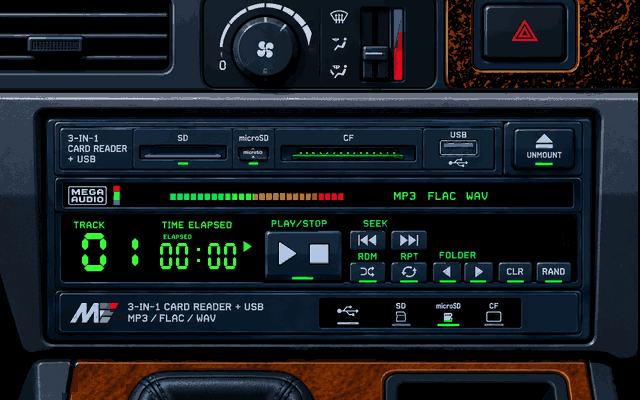
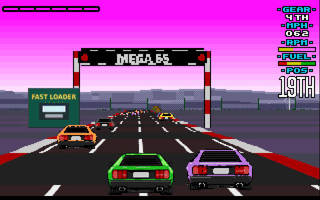
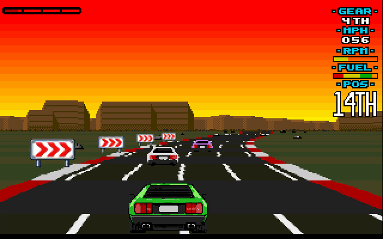

# Wedge Turbo

A racing game for the MEGA65 in the style of the Amiga's racing games
around 1990, with the race on the whole screen.

Work in progress: a season can be driven - choose the level (12, 16 or 20
races) and the controls, then course after course of 48, each a little
harder than the one before, with the result and the championship after
each race; finish outside the first ten and the season is over for you. Road, scenery, opponents and the own car at 25 pictures per
second, with the engines and the sound effects of the race - and the radio:
sixteen tracks of our own for the four SIDs in stereo.

 

 

**[Video: the first race of a season](screenshots/first-race.mp4)**
(3½ minutes, with music and sound; recorded with the self-driving build
described under [Playing](#playing) and `toolchain/tools/bin/mega65-cast`).

## Building

```sh
./build.sh
```

makes `build/wedge-turbo.d81`.

### Touching up the graphics

Every picture the game shows - the cars (and the player's car near), the
scenery in all its sizes, the messages, the backdrops and the pages - can
be touched up by hand in a paint program:

```sh
tools/sheets.py export tmp/graphics     # all of them as PNGs
# ... edit some, save them as PNG under the same names ...
tools/sheets.py import tmp/graphics --dry-run
tools/sheets.py import tmp/graphics     # takes what changed and is valid
./build.sh
```

The sprites keep their sizes and the race's colours (`sheets.json` in the
folder lists each sheet's); the pages are free. What is taken goes to
`art/hand/` and is used instead of what the build would make; delete a file
there to have its picture made again ([tools/sheets.py](tools/sheets.py)).

## Playing

Mount `build/wedge-turbo.d81` and run `WEDGE TURBO` (in Xemu: `-8` with the
image and `-autoload`). Joystick in port 2, or the cursor keys and space.
On the title the car's headlights go up and down until fire is pressed.
The controls page sets the gears (automatic or manual) and what
accelerates (the fire button or the joystick forward) and shows what each
direction does. Before every race the radio: left and right choose one of
sixteen tracks (each plays while it is chosen, the display counts its time;
the engines and the sound effects go on more quietly under it) or 00, off.
Run/Stop gives up a race.

`WEDGE_CFLAGS=-DWEDGE_AUTOTEST ./build.sh` makes a build that goes through
the pages by itself and drives on its own (full gas, holding a line,
round slower cars) - going two tracks on on the radio before each race -
for recordings.
With `-DWEDGE_AUTOTEST_LEVEL=1` (or `2`) besides it plays the medium (hard)
season.

## Inside

* [src/](src/): the game in C and 45GS02 assembly - the race
  ([race.s](src/race.s)), the road ([road.c](src/road.c),
  [render.s](src/render.s); its lines drawn out with smooth edges at the
  start, [road_rows.s](src/road_rows.s)), the season
  ([season.c](src/season.c)) and its pages ([screens.c](src/screens.c), an
  overlay loaded between the races: [link.ld](link.ld)), the sounds
  ([sound.c](src/sound.c)), the music ([music.s](src/music.s), played by
  a timer interrupt; built at build time by
  [tools/mkmusic.py](tools/mkmusic.py)),
  scenery and cars ([sprites.c](src/sprites.c); the player's car near
  as the hardware sprites, twice as fine both ways:
  [carsprite.c](src/carsprite.c)),
  the screen ([video.c](src/video.c)): the picture is drawn into 320×200
  plain bytes and turned into full-colour characters by one DMA list in the
  lower border.
* [tools/](tools/): make what the game loads: the race's tables
  ([mkdata.py](tools/mkdata.py), the numbers in
  [gamedata.py](tools/gamedata.py)), the courses
  ([mkcourses.py](tools/mkcourses.py)), the title's tune and the radio's
  tracks ([radio_tracks.py](tools/radio_tracks.py)), the pages
  ([mkpages.py](tools/mkpages.py), with the drawings in [art/](art/)), the
  cars ([mkcars.py](tools/mkcars.py)), the scenery along the road
  ([mkscenery.py](tools/mkscenery.py); the signs and boards from the
  drawings in [art/signs/](art/signs/)), the mountains behind
  ([mkbackdrops.py](tools/mkbackdrops.py)), the panel and the messages
  over the race ([mkpanel.py](tools/mkpanel.py),
  [mkhud.py](tools/mkhud.py)) and the race's sounds
  ([mksounds.py](tools/mksounds.py)).
* [tests/](tests/): the assembly checked against its C reference.
